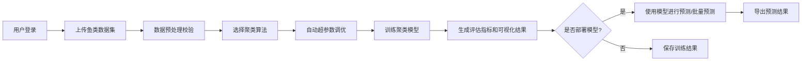
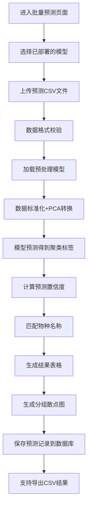
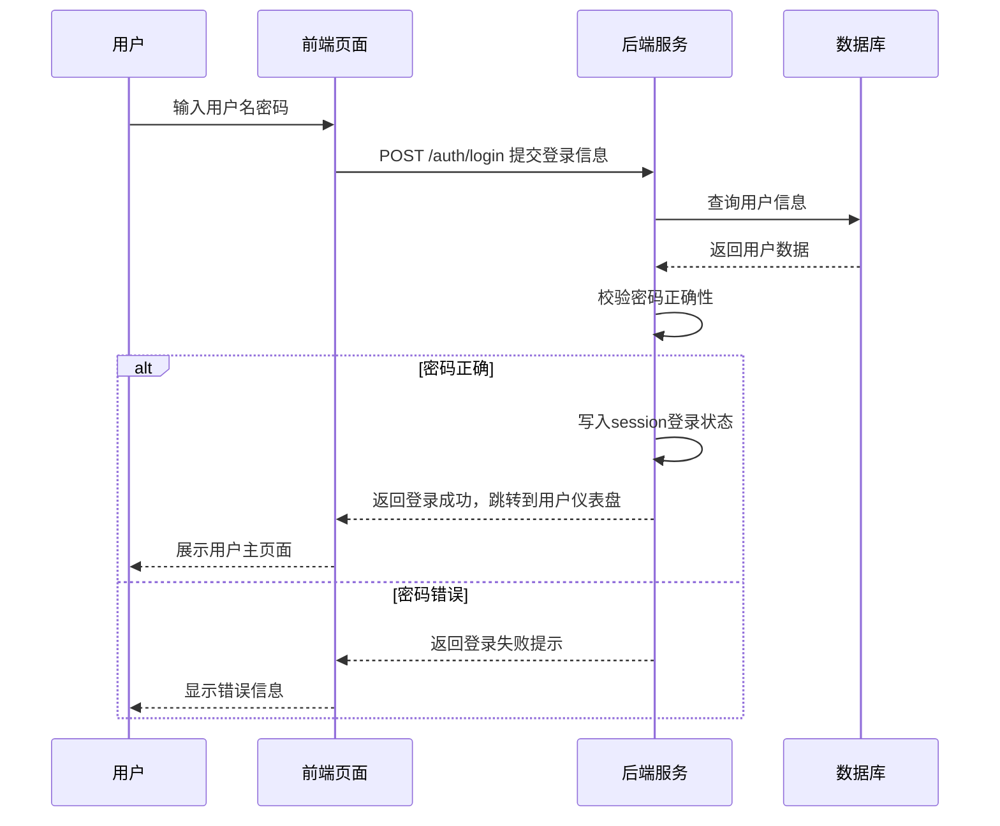
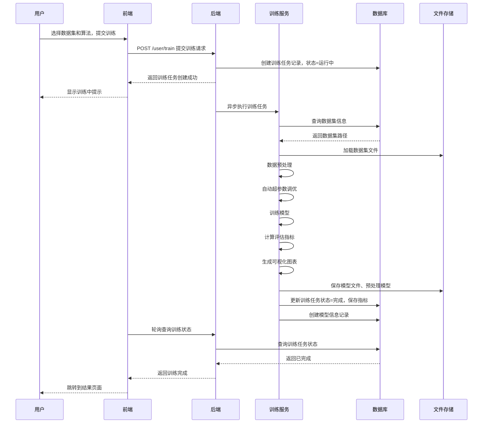
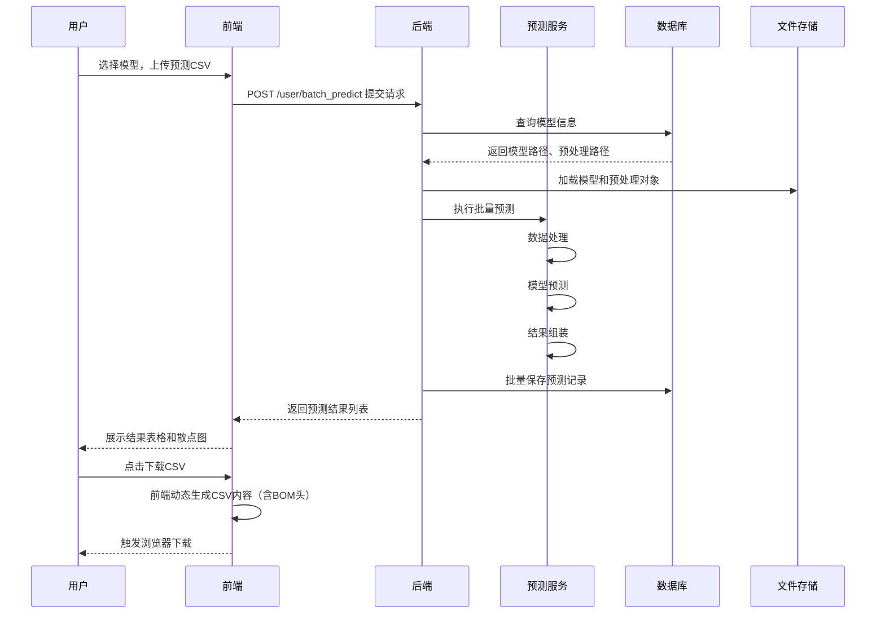

# 鱼类生长分析系统 设计说明文档
> 用于绘制流程图、时序图、架构图等的核心参考文档，内容全面精简，所有流程和结构清晰可查

---

## 一、系统概述
### 1.1 项目背景
针对水产养殖领域鱼类生长数据分类难、人工标注成本高的问题，开发基于无监督聚类算法的鱼类生长分析系统，实现鱼类数据自动分类、生长规律分析、批量预测等功能。

### 1.2 核心目标
- 无需人工标注即可完成鱼类聚类分类
- 支持多种无监督聚类算法，自动调优获得最优效果
- 提供可视化分析结果，直观展示聚类效果
- 支持大规模数据批量预测，提升分析效率

### 1.3 核心功能清单
| 功能模块 | 核心功能 |
|---------|---------|
| 用户管理 | 用户注册/登录、角色权限管理（普通用户/管理员） |
| 数据管理 | CSV数据上传、数据校验、预处理（标准化、PCA降维） |
| 模型训练 | 支持KMeans/BGMM/FCM/MeanShift4种算法、自动超参数调优、模型保存部署 |
| 结果分析 | 聚类评估指标计算、多维度可视化图表、结果导出 |
| 预测功能 | 单条预测、批量预测、结果可视化、CSV导出 |
| 系统管理 | 用户管理、操作日志、数据集/模型全量管理 |

---

## 二、系统架构设计
### 2.1 分层架构（可直接用于绘制架构图）
```
┌─────────────────────────────────────────┐
│ 表现层 (Presentation Layer)              │
│  - 前端页面模板 (HTML/CSS/JS/ECharts)    │
│  - 用户端页面、管理员端页面              │
├─────────────────────────────────────────┤
│ 控制层 (Controller Layer)                │
│  - Flask路由模块                         │
│  - 用户路由、管理员路由、认证路由等      │
├─────────────────────────────────────────┤
│ 业务逻辑层 (Service Layer)               │
│  - 业务逻辑封装                          │
│  - 训练服务、预测服务、数据服务等        │
├─────────────────────────────────────────┤
│ 数据访问层 (DAO Layer)                   │
│  - SQLAlchemy ORM模型                    │
│  - 数据库增删改查操作                    │
├─────────────────────────────────────────┤
│ 算法层 (Algorithm Layer)                 │
│  - 无监督聚类算法实现                    │
│  - KMeans/BGMM/FCM/MeanShift             │
│  - 超参数自动调优、评估指标计算          │
└─────────────────────────────────────────┘
```

### 2.2 技术栈
| 层级 | 技术选型 |
|------|---------|
| 后端框架 | Flask 2.3.3 |
| 数据库 | MySQL 5.7+/8.0 + SQLAlchemy 3.1.1 |
| 机器学习 | scikit-learn 1.3.0 + scikit-fuzzy 0.4.2 |
| 数据处理 | pandas 2.1.1 + numpy 1.24.3 |
| 前端 | HTML + Bootstrap 5 + ECharts 5.4.3 |
| 可视化 | seaborn 0.12.2 + ECharts |

### 2.3 部署架构
```
用户浏览器 → Nginx(可选) → Flask应用服务器 → MySQL数据库
                          ↓
                    本地存储目录：
                    - 数据集上传目录
                    - 模型保存目录
                    - 结果导出目录
```

---

## 三、核心业务流程（可直接用于绘制流程图）
### 3.1 普通用户主流程


### 3.2 管理员主流程
```mermaid
flowchart LR
    A[管理员登录] --> B[用户管理(查看/禁用/删除用户)]
    A --> C[数据集管理(查看/删除所有用户数据集)]
    A --> D[模型管理(查看/部署/删除所有模型)]
    A --> E[查看系统操作日志]
    A --> F[维护系统配置]
```

### 3.3 模型训练完整流程
```mermaid
flowchart TD
    A[提交训练任务] --> B[加载原始数据集]
    B --> C[数据预处理]
    C --> C1[缺失值处理]
    C --> C2[特征工程：计算重长比]
    C --> C3[标准化处理]
    C --> C4[PCA降维(消除多重共线性)]
    C --> D[自动超参数调优]
    D --> D1[遍历参数空间]
    D --> D2[计算SNN相似度矩阵]
    D --> D3[计算综合评估分数]
    D --> D4[选择最优参数组合]
    D4 --> E[训练最终模型]
    E --> F[计算聚类评估指标]
    F --> F1[轮廓系数、CH指数、DB指数]
    F --> F2[有真实标签时计算ARI]
    F --> G[生成可视化图表]
    G --> G1[聚类散点图]
    G --> G2[特征分布直方图]
    G --> G3[混淆矩阵(有标签时)]
    G --> H[保存模型和结果]
    H --> I[训练完成]
```

### 3.4 批量预测流程


---

## 四、时序图说明（可直接用于绘制时序图）
### 4.1 用户登录时序


### 4.2 模型训练时序


### 4.3 批量预测时序


---

## 五、数据模型设计（可直接用于绘制ER图）
### 5.1 核心表结构
| 表名 | 核心字段 | 说明 |
|------|---------|------|
| user | id, username, password, role, create_time | 用户表，role分为admin/user |
| dataset | id, user_id, name, file_path, row_count, has_label, create_time | 数据集表 |
| fish_data | id, dataset_id, species, length, weight, w_l_ratio | 原始鱼类数据表 |
| model_info | model_id, user_id, model_name, algorithm, model_path, preprocessor_path, dataset_id, ari, silhouette_score, ch_score, db_score, is_deployed, create_time | 模型信息表 |
| training_task | id, user_id, dataset_id, algorithm, status, progress, error_msg, create_time | 训练任务表 |
| prediction_record | id, user_id, model_id, length, weight, predicted_label, predicted_species, confidence, create_time | 预测记录表 |
| evaluation_metric | id, model_id, silhouette_score, ch_score, db_score, ari, ari_std, create_time | 评估指标表 |

### 5.2 ER关系
```
用户(user) 1:N 数据集(dataset)
用户(user) 1:N 模型(model_info)
用户(user) 1:N 训练任务(training_task)
用户(user) 1:N 预测记录(prediction_record)
数据集(dataset) 1:N 鱼类数据(fish_data)
数据集(dataset) 1:N 模型(model_info)
模型(model_info) 1:N 预测记录(prediction_record)
模型(model_info) 1:1 评估指标(evaluation_metric)
```

---

## 六、算法设计说明
### 6.1 支持的聚类算法
| 算法 | 核心原理 | 适用场景 |
|------|---------|---------|
| KMeans++ | 基于距离的硬聚类，最小化簇内平方和 | 数据分布较规则、聚类数明确的场景 |
| BGMM(高斯混合模型) | 基于概率分布的软聚类，假设数据来自多个高斯分布混合 | 数据分布呈现高斯混合特征、需要概率输出的场景 |
| FCM(模糊C均值) | 模糊聚类，每个样本属于所有簇的概率和为1 | 样本边界模糊、需要模糊隶属度的场景 |
| MeanShift(均值漂移) | 基于密度的聚类，无需指定聚类数，自动寻找簇中心 | 聚类数未知、数据密度分布不均的场景 |

### 6.2 自动超参数调优策略
1. **评估指标**：采用综合评分 = 轮廓系数(30%) + SNN聚类质量分数(70%)
2. **SNN相似度**：基于样本共享最近邻数量计算相似度，更贴合高维数据聚类效果
3. **参数搜索范围**：
   - KMeans/BGMM/FCM：聚类数搜索范围2~20
   - MeanShift：带宽参数quantile搜索范围0.005~0.1
4. **性能优化**：SNN矩阵缓存、多进程加速计算、参数范围合理剪枝

---

## 七、核心接口清单
| 接口路径 | 请求方式 | 功能说明 | 权限要求 |
|---------|---------|---------|---------|
| /auth/login | POST | 用户登录 | 无需 |
| /auth/register | POST | 用户注册 | 无需 |
| /user/dashboard | GET | 用户仪表盘 | 登录用户 |
| /user/dataset/upload | POST | 上传数据集 | 登录用户 |
| /user/train | POST | 提交训练任务 | 登录用户 |
| /user/task/status | GET | 查询训练任务状态 | 登录用户 |
| /user/result/<task_id> | GET | 查看训练结果 | 登录用户 |
| /user/batch_predict | GET/POST | 批量预测 | 登录用户 |
| /admin/user/list | GET | 用户列表 | 管理员 |
| /admin/model/deploy | POST | 部署模型 | 管理员 |

---

## 八、部署说明
### 8.1 环境要求
- Python 3.8+
- MySQL 5.7+/8.0
- 内存≥4G，CPU≥2核

### 8.2 部署步骤
1. 安装依赖：`pip install -r requirement.txt`
2. 配置数据库：执行`database/fish_system.sql`初始化数据库
3. 修改配置：`config.py`中修改数据库连接地址
4. 启动服务：`python app.py` 或双击`start_system.bat`
5. 访问地址：http://localhost:5000